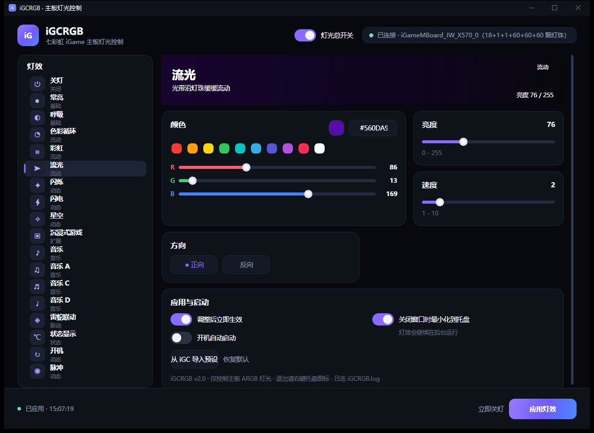

<p align="center">
  <a href="README.md"></a>
  <a href="README.en.md"></a>
</p>

# iGCRGB

> 七彩虹 iGame 主板灯光的独立控制面板 —— 不启动 iGC，也能用回你的灯效预设。

[](https://www.deepseek.com/)

> 🤖 **本项目完全由 DeepSeek 开发。**
> 全部 C# 源码、WPF 界面、PowerShell 构建脚本与文档均由 DeepSeek AI 编写；
> 人类仅负责提出需求、在真实硬件上测试以及发布维护。



## 为什么做这个

用 iGC.Lite 控制主板灯光时，每次开机都得把整个软件跑起来：风扇、LCD、硬件监控、广告等模块会一起加载，还会常驻后台。

**iGCRGB** 把其中「灯光控制」这一条链路单独提取了出来：

- 双击一个 exe 就能打开设置面板，不再需要打开 iGC；
- 面板里完整提供了 iGC 灯光页的全部灯效与参数（18 种灯效、颜色、亮度、速度、方向、灵敏度、温度显示、灯光总开关）；
- 只加载主板灯光所需的 3 个官方组件，后台 CPU 约 **0.2%**，最小化到托盘后内存可回收到几 MB；
- 支持开机自动以托盘模式启动并应用灯光。

## 特性

- 🎛 **完整灯效面板**：关灯 / 常亮 / 呼吸 / 色彩循环 / 彩虹 / 流光 / 闪烁 / 闪电 / 星空 / 沉浸式游戏 / 音乐 / 音乐 A / 音乐 C / 音乐 D / 雷蛇联动 / 状态显示 / 开机 / 脉冲
- 🎨 **可视化调色**：快捷色块、R/G/B 滑杆、十六进制输入；每种灯效独立记忆自己的颜色与参数
- ⚡ **即时生效**：拖动参数后约 0.4 秒自动下发（可关闭该选项，改用手动「应用灯效」）
- 🔁 **从 iGC 导入**：首次启动自动读取 iGC 已保存的整套预设，之后可脱离 iGC 使用
- 🖥 **托盘常驻**：关闭窗口即最小化到托盘，灯效继续运行；再次双击 exe 会唤起已有窗口
- 🚀 **开机自启**：面板内一键开关，启动时以 `--tray` 静默运行（不需要管理员权限）
- 🌙 **睡眠唤醒恢复**：系统从睡眠/休眠唤醒后自动重新初始化灯效
- 📦 **零额外依赖**：仅需 Windows 自带的 .NET Framework 4.8，无 NuGet 包、无驱动、无服务

## 重要声明（请先阅读）

- 本项目是**非官方**的第三方工具，与七彩虹（Colorful）没有任何隶属或授权关系。
- 本仓库**不包含**任何七彩虹的源代码或二进制文件。运行所需的 `iGameAPI.Contracts.dll`、`iGameAPI\*.dll` 等闭源组件，需要你从**自己安装的 iGC.Lite** 中复制（见下方构建步骤）。
- 本项目通过调用厂商组件公开的托管封装 / 导出接口来下发灯效，不复刻、不反编译其灯光协议实现。
- 修改主板 RGB 一般不会损坏硬件，但仍请自行评估风险；作者不对任何直接或间接损失负责。
- 如果你要分发本项目的构建产物，请务必删除其中的七彩虹组件，让使用者自行准备。

## 系统要求

| 项目 | 要求 |
| --- | --- |
| 操作系统 | Windows 10 / 11 64 位 |
| 运行时 | .NET Framework 4.8（Win10 1903+ / Win11 自带） |
| 硬件 | 带 ARGB 灯控的七彩虹 iGame / 战斧系列主板 |
| 构建 | .NET SDK 8（或 6/7） |
| 依赖组件 | 官方 iGC.Lite（提供闭源的灯光组件） |

## 从源码构建

### 1. 安装 iGC.Lite

从七彩虹官网安装 iGC（iGame Center）。默认安装路径通常是 `E:\iGC.Lite`。

确认安装目录里存在以下文件：

```
iGC.Lite\
├─ iGameAPI.Contracts.dll
└─ iGameAPI\
   ├─ iGameMBoard.dll
   ├─ iGameEasyCalc.dll
   ├─ iGameSpaceCalc.dll
   ├─ msvcp140.dll
   ├─ vcruntime140.dll
   └─ vcruntime140_1.dll
```

### 2. 复制厂商组件到 vendor/

```powershell
powershell -ExecutionPolicy Bypass -File scripts\prepare-vendor-libs.ps1 -IgcPath "E:\iGC.Lite"
```

不传 `-IgcPath` 时会自动在 `E:\iGC.Lite`、`D:\iGC.Lite`、`C:\iGC.Lite`、`Program Files` 下查找。

### 3. 构建

```powershell
powershell -ExecutionPolicy Bypass -File scripts\build.ps1
```

脚本会编译项目、组装运行目录，输出：

```
dist\iGCRGB\
├─ iGCRGB.exe
├─ iGCRGB.exe.config
├─ iGameAPI.Contracts.dll
├─ iGameAPI\...（厂商组件）
└─ 使用说明.txt
```

双击 `dist\iGCRGB\iGCRGB.exe` 即可运行。

额外参数：

```powershell
# Debug 构建
powershell -ExecutionPolicy Bypass -File scripts\build.ps1 -Configuration Debug

# 同时生成 dist\iGCRGB_v2.0.0.zip
powershell -ExecutionPolicy Bypass -File scripts\build.ps1 -Zip
```

也可以直接用 MSBuild/dotnet：

```powershell
dotnet build src\iGCRGB.Gui\iGCRGB.Gui.csproj -c Release -p:VendorDir="D:\some\vendor\"
```

## 使用

完整的中文说明见 [docs/USAGE_zh.txt](docs/USAGE_zh.txt)。要点：

1. 双击 `iGCRGB.exe` 打开面板；
2. 左侧选择灯效，右侧调参数；勾选「调整后立即生效」时会自动下发；
3. 右上角「灯光总开关」相当于 iGC 的关灯；
4. 关闭窗口默认最小化到托盘，右键托盘图标可退出；
5. 「应用与启动」里可以设置开机自启、关闭窗口行为，以及从 iGC 重新导入预设。

> ⚠️ 不要同时运行 iGC 和 iGCRGB：两者都会占用主板 RGB 控制器，会互相抢灯。

## 工作原理

```
iGCRGB (WPF)
   │  调用
   ▼
iGameAPI.Contracts.dll（七彩虹托管封装，P/Invoke）
   │
   ├── iGameMBoard.dll      主板 RGB 控制器（HID 通信）
   ├── iGameEasyCalc.dll    灯效逐帧计算引擎
   └── iGameSpaceCalc.dll   空间灯效引擎（本工具仅初始化，不参与）
```

应用启动时按与 iGC 完全一致的顺序初始化：

1. 停止可能残留的灯效引擎；
2. 初始化 `iGameSpaceCalc` / `iGameEasyCalc`；
3. 枚举主板灯光设备并读取通道信息；
4. 将设备切换到 EasyCalc 统一驱动模式；
5. 组装 `iGameEasyCalc_LEDParameter`（效果类型、颜色、亮度、速度、方向、帧率）并下发；
6. 常驻进程维持逐帧渲染；状态显示灯效额外下发温度数据。

细节见 [docs/architecture.md](docs/architecture.md)。

## 配置文件与日志

- `settings.json`：与 exe 同目录（目录不可写时放到 `%LOCALAPPDATA%\iGCRGB\`），保存全部灯效参数和界面选项。
- `iGCRGB.log`：运行日志，排错时先看这里。

## 已知限制

- 只控制主板灯光（iGC 识别到的 MotherBoard 设备），不处理显卡 / 内存 / 键盘 / 控制器灯效。
- 未移植 iGC 的「空间灯控」（在画布上摆放灯珠的编辑器），面板对应的是普通「整体」模式。
- 沉浸式游戏、雷蛇联动、音乐类灯效在 iGC 中还依赖额外模块或实时数据，本工具只下发基础参数，效果可能不完整。
- 「状态显示」灯效需要温度数据，本工具无法读取硬件温度，使用面板中手动设定的温度值。
- 与 iGC 不能同时运行。

## 项目结构

```
iGCRGB/
├─ src/iGCRGB.Gui/            WPF 应用
│  ├─ Core/                   灯光引擎、配置模型、JSON、自启、日志
│  ├─ Themes/Theme.xaml       深色主题与控件样式
│  ├─ Converters/             绑定转换器
│  ├─ App.xaml(.cs)           启动、单实例、托盘
│  └─ MainWindow.xaml(.cs)    设置面板
├─ scripts/
│  ├─ prepare-vendor-libs.ps1 复制厂商组件到 vendor/
│  └─ build.ps1               构建 + 组装 dist/
├─ docs/                      截图、使用说明、架构说明
├─ vendor/                    厂商组件放置目录（不入库）
└─ LICENSE                    MIT
```

## 贡献

欢迎提 Issue / PR。提交前请注意：

- 不要在仓库、Issue 或 PR 中上传任何七彩虹的二进制文件；
- 保持 C# 7.3 / .NET Framework 4.8 的兼容性（项目刻意不引入第三方依赖）；
- 涉及硬件的改动请在 PR 中描述测试环境与主板型号。

## 开发说明

本项目是一次「AI 独立开发」的尝试：

- 需求拆解、硬件链路分析、C# / WPF 代码编写、界面设计、构建脚本与全部文档，**均由 DeepSeek 完成**；
- 人类只负责提出需求、在真实主板上测试验证，以及发布与维护；
- 仓库中的每个提交都可以追溯到具体的对话需求。

如果你要引用、转载或介绍本项目，欢迎注明：**“Developed entirely by DeepSeek AI”**。

## 许可证

本项目代码以 [MIT License](LICENSE) 发布。
开发与版权声明见 [NOTICE](NOTICE)。
七彩虹 iGC / iGame Center 及其组件版权归原权利人所有，不在本许可证覆盖范围内。

## English

Looking for the English version? See **[README.en.md](README.en.md)**.

**iGCRGB** is an unofficial, lightweight WPF control panel for Colorful (七彩虹) iGame motherboard ARGB lighting. It reuses the vendor's own lighting components (which you must copy from your local iGC.Lite installation) and reproduces the same initialization sequence iGC uses, so you can apply lighting presets without launching the full iGC software.

**Developed entirely by DeepSeek AI** — all source code, UI, build scripts and documentation. Human involvement was limited to requirements, on-hardware testing and publishing.

The repository does **not** contain any proprietary Colorful binaries. Build steps are described above. Licensed under MIT (source code only).
